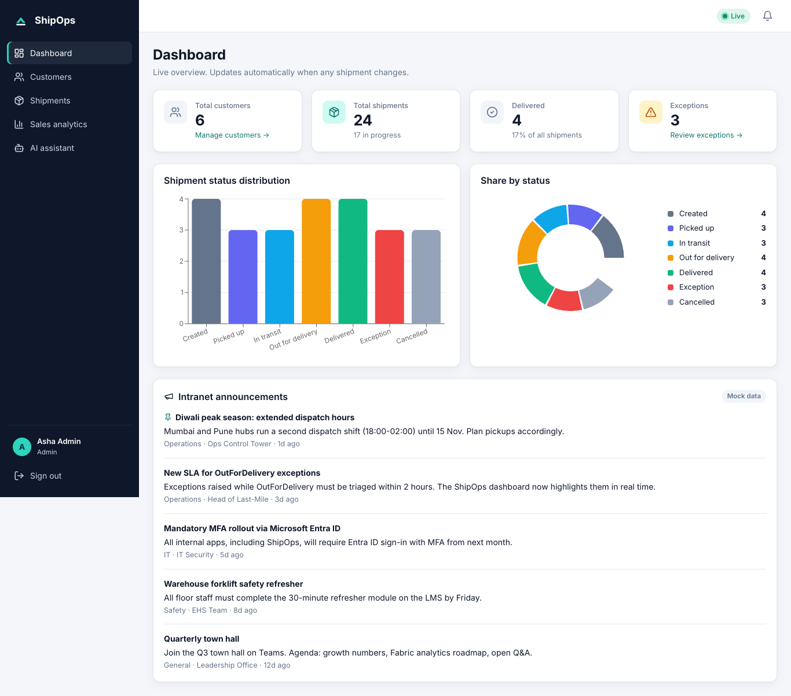
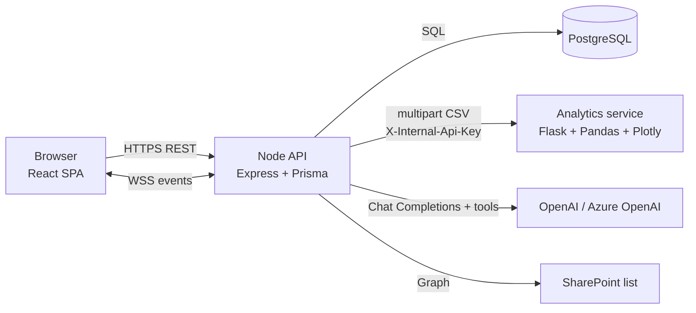
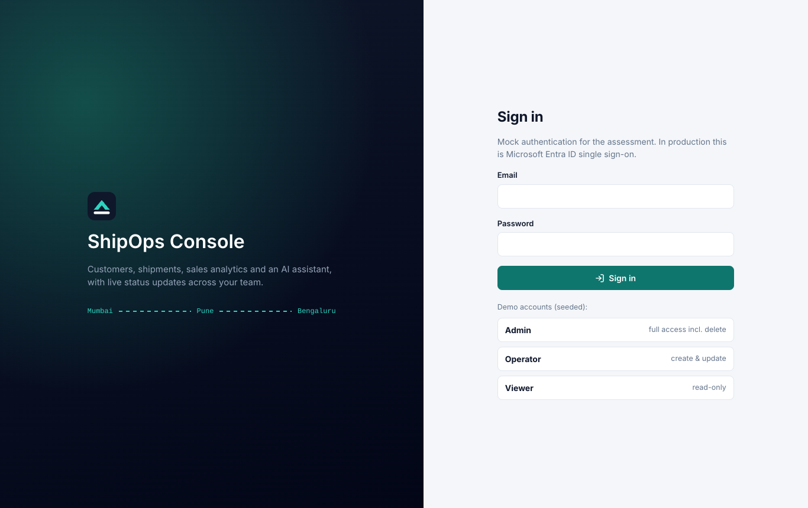
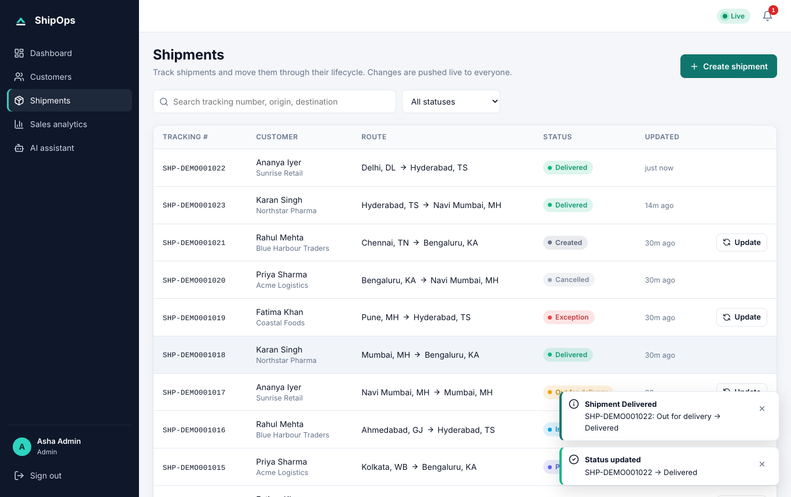
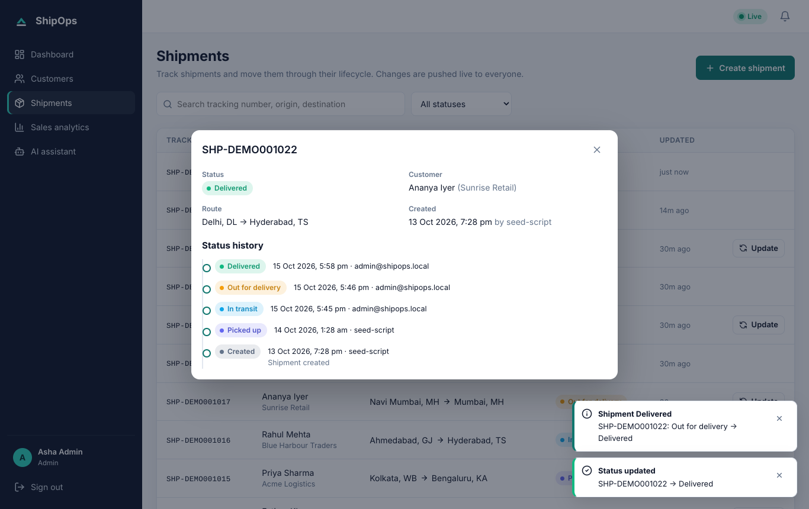
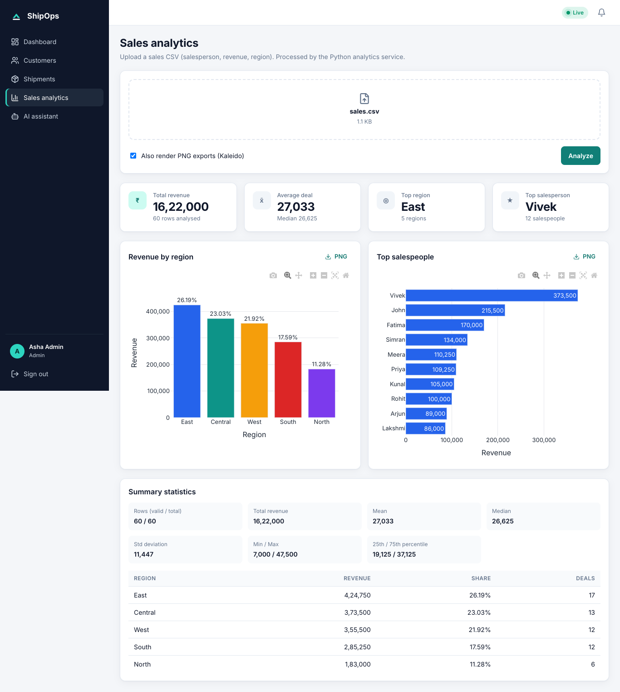
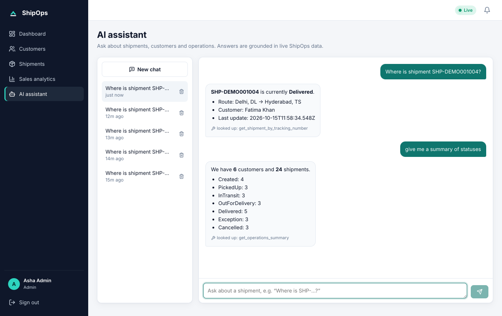
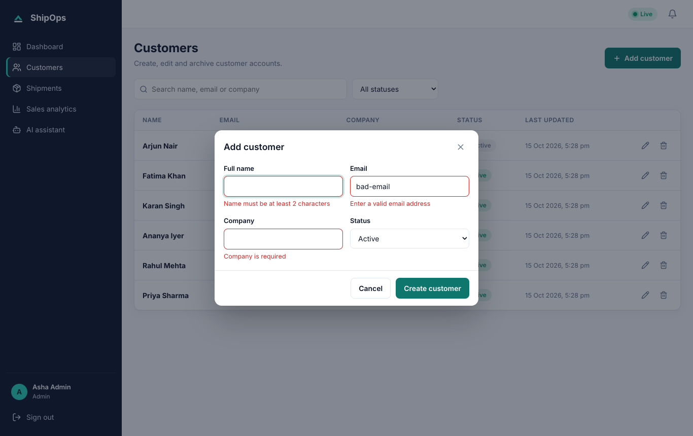

# ShipOps Platform

Full-stack solution for the **RBHU ETG Full Stack Engineer technical assessment**: an internal platform to manage customers and shipments, analyse sales data, talk to an AI assistant and receive real-time notifications, designed for deployment on Microsoft Azure.



## What's in the box

| Assessment item | Where | Highlights |
|---|---|---|
| **Module 1** Customer & Shipment API | `backend/` | Express + TypeScript, Prisma + PostgreSQL, Zod validation, service/repository layers, soft delete, audit fields, shipment state machine with optimistic concurrency, Swagger at `/api-docs` |
| **Module 2** React frontend | `frontend/` | React + TS (Vite), mock login, dashboard with status distribution, customer & shipment CRUD, React Query state, react-hook-form + Zod, responsive (mobile card tables) |
| **Module 3** Sales analytics | `analytics/` | Flask + Pandas + Plotly, `POST /analyze`, revenue-by-region & top-salespeople charts, summary statistics, **bonus Kaleido PNG export** |
| **Module 4** AI assistant | `backend/src/modules/chat` | `POST /api/chat`, OpenAI **or** Azure OpenAI, persisted conversation history, tool calling grounded in live shipment data, graceful errors, offline mock provider |
| **Module 5** Real-time notifications | `backend/src/realtime` | Native WebSockets (`ws`), JWT-authenticated upgrade, heartbeat, backpressure, pub/sub seam for scale-out |
| **Module 6** Azure deployment design | `docs/deployment-azure.md`, `infra/` | Architecture diagram, App Service, PostgreSQL Flexible Server, Entra ID, Key Vault, VNet + private endpoints, Bicep, CI/CD |
| Security requirements | throughout | JWT **or** Entra ID token validation, RBAC, Zod everywhere, Helmet, CORS allow-list, rate limits, secret handling |
| **Bonus 1** Microsoft Fabric | `docs/bonus-fabric.md` | Mirroring design, medallion lakehouse, Power BI |
| **Bonus 2** Voice agent | `docs/bonus-voice-agent.md` | ACS Call Automation + Voice Live, tool calls into the shipment API |
| **Bonus 3** SharePoint | `GET /announcements` + `docs/bonus-sharepoint.md` | Mocked endpoint plus a working Microsoft Graph provider behind a flag |

## Architecture at a glance



The browser talks only to the Node API. The API is the single place where authentication, validation, rate limiting and CORS are enforced; the analytics service sits behind it and is not exposed publicly. Full rationale and trade-offs: [docs/architecture.md](docs/architecture.md). Azure target architecture: [docs/deployment-azure.md](docs/deployment-azure.md).

## Quick start

### Option A: Docker (everything in one command)

```bash
docker compose up --build
```

| URL | What |
|---|---|
| http://localhost:8080 | Web app |
| http://localhost:4000/api-docs | Swagger UI |
| http://localhost:5001/health | Analytics service |

Migrations and demo data are applied automatically on API start.

### Option B: Run each service locally

Prerequisites: Node 20+, Python 3.10+, PostgreSQL 14+ (or `docker compose up db`).

```bash
# 1. Database
docker compose up -d db

# 2. API (http://localhost:4000)
cd backend
cp .env.example .env
npm install                 # also runs `prisma generate`
npx prisma migrate deploy   # applies prisma/migrations
npm run db:seed             # demo users, customers, shipments
npm run dev

# 3. Analytics service (http://localhost:5001)
cd analytics
python -m venv .venv && source .venv/bin/activate   # Windows: .venv\Scripts\activate
pip install -r requirements-dev.txt
cp .env.example .env
INTERNAL_API_KEY=dev-internal-key-change-me flask --app wsgi run -p 5001

# 4. Web app (http://localhost:5173, proxies /api and /ws to :4000)
cd frontend
npm install
npm run dev
```

### Demo accounts

| Role | Email | Password | Can |
|---|---|---|---|
| Admin | `admin@shipops.local` | `Admin@123` | everything, incl. soft-deleting customers |
| Operator | `operator@shipops.local` | `Operator@123` | create/update customers & shipments |
| Viewer | `viewer@shipops.local` | `Viewer@123` | read-only |

The login screen has one-click buttons for these.

### Using a real LLM

The assistant runs in **mock mode** by default so the project works offline. To use a real model set, in `backend/.env`:

```bash
AI_PROVIDER=openai
OPENAI_API_KEY=sk-...
# or
AI_PROVIDER=azure
AZURE_OPENAI_ENDPOINT=https://<resource>.openai.azure.com
AZURE_OPENAI_API_KEY=...
AZURE_OPENAI_DEPLOYMENT=gpt-4o-mini
```

Try: *"Where is SHP-DEMO001004?"*, *"Give me a shipment summary"*, *"Find customers at Acme"*.

### Try the real-time notifications

Open the app in two browser windows (e.g. Admin and Viewer). Change a shipment status in one; the other shows a toast, the bell counter increments and the dashboard/list refresh without reloading. Or from a terminal:

```bash
npx wscat -c "ws://localhost:4000/ws?token=<JWT>" -s shipops.v1
```

## Tests

| Service | Command | Coverage |
|---|---|---|
| API (unit) | `cd backend && npm test` | services, state machine, validation, chat history, mock AI |
| API (integration) | `RUN_INTEGRATION=1 DATABASE_URL=postgresql://.../shipops_test npm test` | real Postgres: auth, RBAC, CRUD, soft delete, **WebSocket broadcast**, chat persistence |
| Analytics | `cd analytics && pytest` | CSV validation, statistics, auth, Kaleido PNG |
| Web | `cd frontend && npm test` | form validation, components, error mapping |

Results at time of submission: API 31/31 (incl. 7 integration), analytics 11/11, web 5/5; `tsc` clean on API and web; production builds succeed.

## Repository layout

```
.
├── backend/            Node.js API (Modules 1, 4, 5, Bonus 3)
│   ├── prisma/         schema.prisma, migrations/, seed.ts
│   ├── src/
│   │   ├── config/     zod-validated environment
│   │   ├── lib/        logger, prisma, errors, zod/openapi registry
│   │   ├── middleware/ auth (JWT/Entra + RBAC), validation, errors, request id
│   │   ├── modules/    auth, customers, shipments, dashboard, chat, analytics, announcements
│   │   │               (each: schemas → repository → service → routes)
│   │   ├── realtime/   notification bus + WebSocket server
│   │   ├── container.ts  composition root (dependency injection)
│   │   └── app.ts, server.ts
│   └── tests/          unit (in-memory fakes) + integration (HTTP + WS)
├── analytics/          Flask microservice (Module 3)
├── frontend/           React app (Module 2)
├── infra/              Bicep templates for Azure (Module 6)
├── .github/workflows/  CI and deployment pipelines
├── docs/               architecture, API, schema, env vars, Azure, bonus designs, demo script
└── sample-data/        CSVs for the analytics module
```

## Documentation

| Document | Contents |
|---|---|
| [Architecture & design decisions](docs/architecture.md) | components, request flows, trade-offs, scalability, security model |
| [API documentation](docs/api.md) | endpoints, examples, error format, WebSocket protocol (full spec: Swagger / [`docs/openapi.json`](docs/openapi.json)) |
| [Database schema](docs/database-schema.md) | ER diagram, tables, soft delete & audit strategy, indexes |
| [Environment variables](docs/environment-variables.md) | every variable for every service |
| [Azure deployment guide](docs/deployment-azure.md) | Module 6: hosting, DB, Entra ID, Key Vault, networking, deployment strategy, security, CI/CD |
| [Bonus 1: Microsoft Fabric](docs/bonus-fabric.md) | sync design, data flow, reporting |
| [Bonus 2: Voice agent](docs/bonus-voice-agent.md) | phone → speech → shipment lookup → spoken reply |
| [Bonus 3: SharePoint](docs/bonus-sharepoint.md) | `/announcements` PoC and Graph integration |
| [Demo walkthrough](docs/demo-walkthrough.md) | 10–15 minute script for the presentation |

## Screenshots

| | |
|---|---|
|  |  |
|  |  |
|  |  |
