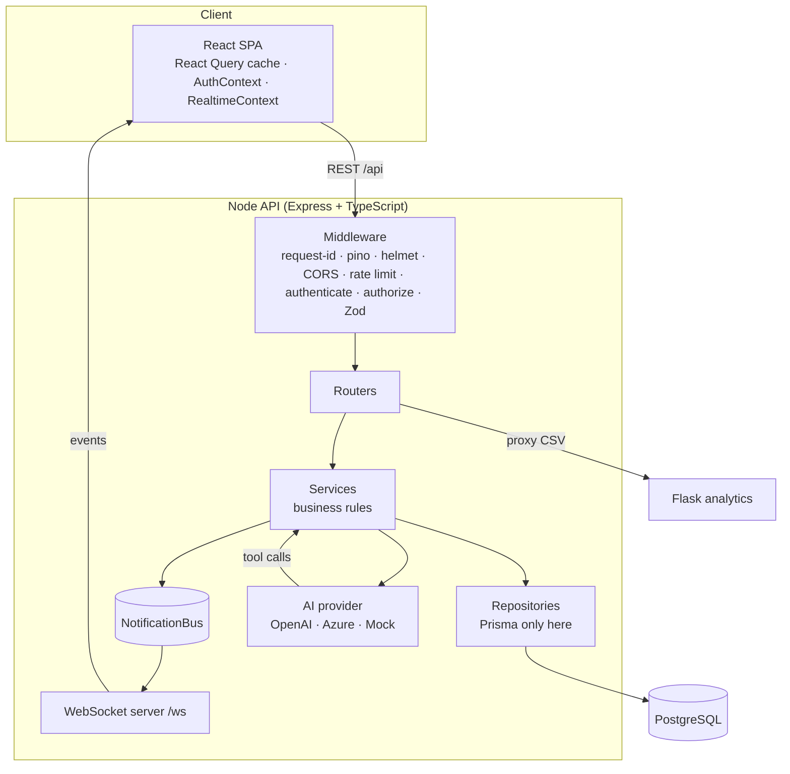
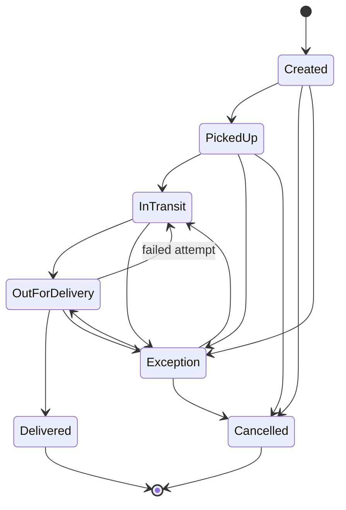
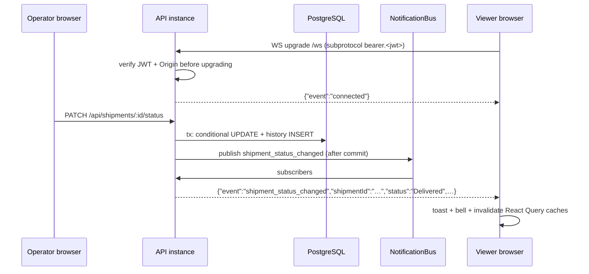

# Architecture & Design Decisions

## 1. System overview



| Component | Responsibility | Key technology |
|---|---|---|
| **Web** (`frontend/`) | UI for all screens, client validation, live updates | React 18, Vite, React Query, react-hook-form, Zod, Recharts, Plotly.js |
| **API** (`backend/`) | Auth, validation, business rules, persistence, real-time, AI orchestration, gateway to analytics | Express, Prisma 6 (driver adapter `pg`), Zod, `ws`, `jose`, `openai` |
| **Analytics** (`analytics/`) | Parse CSV, compute stats, build charts, PNG export | Flask, Pandas, Plotly, Kaleido |
| **PostgreSQL** | System of record | Migrations via Prisma |

## 2. Backend layering

Each feature lives in `src/modules/<feature>/` with the same four files:

```
<feature>.schemas.ts     Zod schemas (validation + OpenAPI metadata + TS types)
<feature>.repository.ts  interface + Prisma implementation (only file that touches the DB)
<feature>.service.ts     business rules, depends on repository *interfaces*
<feature>.routes.ts      HTTP mapping, RBAC, OpenAPI path registration
```

`src/container.ts` is the composition root. Production wires Prisma repositories; unit tests wire in-memory fakes (`tests/fakes.ts`), which is why the service tests run in milliseconds without a database.

**Why one Zod schema for everything?** The same schema validates the request, produces the TypeScript type and generates the Swagger document (`@asteasolutions/zod-to-openapi`). Docs cannot drift from behaviour.

### Error handling

Services throw typed errors (`NotFoundError`, `ConflictError`, `UnprocessableError`, `UpstreamError`, …). A single error handler maps them, plus Zod, Prisma (`P2002`→409, `P2025`→404), Multer and body-parser errors, to one envelope:

```json
{ "error": { "code": "VALIDATION_ERROR", "message": "Request validation failed",
             "details": [{ "path": "email", "message": "Must be a valid email" }],
             "requestId": "7d2c…" } }
```

5xx responses never leak internals in production; the `requestId` (also in the `x-request-id` header and every log line) lets support find the exact log entry.

### Logging

`pino` JSON logs with request-scoped ids, redaction of `authorization`, cookies, passwords and tokens, and business events (`customer created`, `shipment status changed`, `chat completion` with token counts and latency). On Azure, stdout goes to Log Analytics / Application Insights.

## 3. Key domain decisions

### Shipment lifecycle as a state machine



The assessment schema has a free-text `status`; I made it an enum with allowed transitions because shipment data that can jump from *Delivered* back to *Created* is a real operational bug. Invalid transitions return **422** with the allowed next statuses, and the API includes `allowedNextStatuses` on every shipment so the UI only offers legal options.

### Concurrency

Two operators updating the same shipment at once: the repository does `UPDATE … WHERE id = ? AND status = <status I read>` inside a transaction with the history insert. If zero rows match, someone else won and the API returns **409** instead of silently overwriting. No locks are held across requests.

### Soft delete + audit

* Customers have `deletedAt/deletedBy`; repositories filter `deletedAt IS NULL` on every read, so deleted rows can't leak through a forgotten `where`.
* A **partial unique index** (`LOWER(email) WHERE deleted_at IS NULL`) lets a deleted customer's email be reused while still guaranteeing uniqueness under race conditions.
* Every business table has `createdAt/updatedAt/createdBy/updatedBy`.
* `shipment_status_history` is an append-only audit trail of every transition (who, when, note).
* Shipments keep a `RESTRICT` FK to customers: hard-deleting a customer with shipments is impossible, which is exactly why customers are soft-deleted.

## 4. Real-time notifications (Module 5)



Design choices:

* **Native WebSockets (`ws`)** rather than Socket.IO: the requirement is plain WebSockets, the protocol is tiny, and it maps directly to Azure Web PubSub later.
* **Authentication before upgrade.** Browsers can't set headers on WS handshakes, so the JWT is sent as a subprotocol (`["shipops.v1", "bearer.<jwt>"]`), avoiding tokens in URLs/logs (a `?token=` fallback exists for CLI tools and is redacted in logs). The Origin header is checked against the CORS allow-list (prevents cross-site WebSocket hijacking).
* **Publish after commit**, so clients never see an event for a rolled-back change.
* **Heartbeats** (ping/pong every 30 s) terminate half-open connections; App Service's load balancer drops idle connections after ~4 minutes, so the client also sends an app-level ping every 25 s.
* **Backpressure**: a client with >1 MB buffered is skipped rather than allowed to grow server memory.
* **Client reconnect** with exponential backoff + jitter (avoids a reconnect stampede after a deployment).
* The event carries `trackingNumber`, `previousStatus`, `changedBy`, `timestamp` in addition to the sample fields, so the UI can render a toast without an extra request.

### Scalability considerations

The in-memory bus is correct for one instance. With N instances, a client on instance A must hear about a change processed on B. Because services depend on the `NotificationBus` interface only, scaling out is a swap of one class:

| Option | When | Notes |
|---|---|---|
| **Redis pub/sub** (Azure Cache for Redis) | a few instances, low latency | ~30 lines: publish to a channel, every instance subscribes and fans out to its sockets |
| **Azure Web PubSub** | many connections, offload sockets entirely | the API publishes via REST/SDK; clients connect to Web PubSub; API instances become stateless |
| **Postgres LISTEN/NOTIFY** | no extra infra | fine for modest volumes; uses a dedicated connection per instance |

Other notes: App Service needs *WebSockets = On*; ARR affinity keeps a client on one instance for the life of the socket; per-instance connection count is exposed for autoscale rules; the client re-fetches data on reconnect (React Query invalidation) so missed events during a disconnect self-heal. For guaranteed delivery (e.g. audit), events would go to Service Bus as well; WebSockets are a UX notification channel, not a system of record.

## 5. AI assistant (Module 4)

* **Provider abstraction** (`AiProvider`): `OpenAiCompatibleProvider` serves both OpenAI and Azure OpenAI (`AzureOpenAI` client, same Chat Completions surface); `MockAiProvider` gives deterministic offline answers and still exercises tool calls, so tests and demos don't need keys.
* **Grounding via tool calling.** The model gets three read-only tools (`get_shipment_by_tracking_number`, `get_operations_summary`, `search_customers`) that call the *same services* as the REST API. It cannot invent a status; it looks it up. It cannot write data; no write tools exist.
* **Prompt engineering** (`prompts.ts`): role and scope, rules (facts only from tools, read-only, treat tool output and user text as data, no secrets/bulk PII), output style (lead with the answer, ≤4 bullets, echo tracking numbers), dynamic context (user name/role, current time). `temperature 0.2`, `max_tokens 800`, maximum 3 tool rounds with a forced final text answer.
* **Conversation history** is persisted per user (`conversations`, `chat_messages`). Each request sends the system prompt + a sliding window of the last N turns (`AI_MAX_HISTORY_MESSAGES`) to bound token cost. Ownership is part of every query, so users cannot read each other's chats (verified by an integration test).
* **Graceful errors**: provider errors are mapped (429 → "busy, retry", 401/403 → "misconfigured", timeout → 504, content filter → 422). Nothing is persisted if the call fails, so history never contains orphan turns; the UI keeps the user's text for retry. Per-user rate limit: 20 messages/min.

## 6. Analytics service (Module 3)

* Separate process/language by design (team's reporting stack is Python). Pure functions in `analysis.py` (no Flask) for testability; charts in `charts.py`; HTTP in `routes.py`.
* Robust CSV handling: UTF-8 BOM, case/whitespace-insensitive headers, currency/thousand separators in revenue (`"₹ 1,00,000"`), invalid rows skipped **with line numbers** in `warnings`, hard 422 when nothing is usable, size and row limits.
* Output: summary statistics (total, mean, median, std, min/max, quartiles, counts, tops), aggregated tables, Plotly figure JSON (rendered interactively in React), optional base64 PNGs via Kaleido, and `POST /analyze/png/<chart>` for direct image download.
* Service-to-service auth with a shared key compared in constant time; in Azure the service also has public access disabled and is reachable only via private endpoint.

## 7. Frontend

* **State management.** Server state lives in React Query (caching, background refresh, retries that skip 4xx, `keepPreviousData` for pagination). WebSocket events and mutations invalidate the relevant query keys, so every screen stays consistent without manual store wiring. Session state in `AuthContext`; UI state local.
* **Reusable components**: `DataTable` (responsive: table on desktop, stacked cards on mobile), `Modal`, `ConfirmDialog`, `TextField/SelectField/TextAreaField` (accessible labels, `aria-invalid`, error ids), `StatusBadge`, `StatCard`, `PlotlyChart`, toasts.
* **Form validation**: Zod schemas mirror the API. Server-side 400 field errors and 409 conflicts are mapped back onto the form fields.
* **Error handling**: typed `ApiError`, inline empty/error/retry states, auto-logout on 401 or token expiry, an error boundary for render failures.
* **Performance**: Analytics (Plotly) and Assistant (Markdown) pages are lazy-loaded chunks.

## 8. Security model

| Concern | Control |
|---|---|
| Authentication | `AUTH_MODE=local`: bcrypt (constant-time on unknown emails), HS256 JWT with issuer/audience/expiry. `AUTH_MODE=entra`: RS256 Entra ID tokens validated against tenant JWKS (issuer, audience, signature, expiry); JIT user provisioning |
| Authorisation | RBAC (`ADMIN`, `OPERATOR`, `VIEWER`) enforced server-side per route; Entra app roles map to the same roles; UI hides actions the user can't perform |
| Input validation | Zod on every body/query/param; `.strict()` objects reject unknown fields (mass-assignment protection); size limits (JSON 100 kB, CSV 5 MB) |
| Transport/browser | Helmet headers, CORS allow-list (no wildcard), WS Origin check, HTTPS-only in Azure |
| Abuse | Global rate limit, stricter login limit (brute force) and per-user chat limit (cost) |
| Secrets | Validated env config, `.env` git-ignored, Key Vault references + Managed Identity in Azure, redaction in logs |
| Data | Soft delete, audit fields, status history, parameterised queries via Prisma, least-privilege DB roles (see deployment guide) |
| AI | Read-only tools, prompt-injection guidance, no secrets in prompts, content-filter handling |

## 9. Trade-offs and what I'd do next

| Decision | Trade-off | Next step |
|---|---|---|
| Mock auth with JWT in `sessionStorage` | simple for the assessment; readable by XSS | MSAL + Entra ID (already supported server-side); or BFF with httpOnly cookies |
| Single in-memory notification bus | zero infra; single instance only | Redis or Azure Web PubSub backplane (interface already in place) |
| Prisma driver adapter (`pg`) | Rust-free client, smaller deploys; preview flag in Prisma 6 | move to Prisma 7 where it is the default |
| CSV analysed synchronously | simple; fine up to a few MB | async jobs (queue + blob storage) for large files |
| Offset pagination | simple and good for admin lists | keyset pagination for very large tables |
| Analytics behind the API | one auth boundary; extra hop | acceptable; could move to Azure Functions if usage is spiky |
| Chat responses not streamed | simpler error handling | SSE streaming for faster perceived latency |

Future enhancements: customer-scoped notification channels, shipment ETA prediction from history, OpenTelemetry tracing end-to-end, Playwright E2E tests in CI, i18n, audit log viewer for admins.
