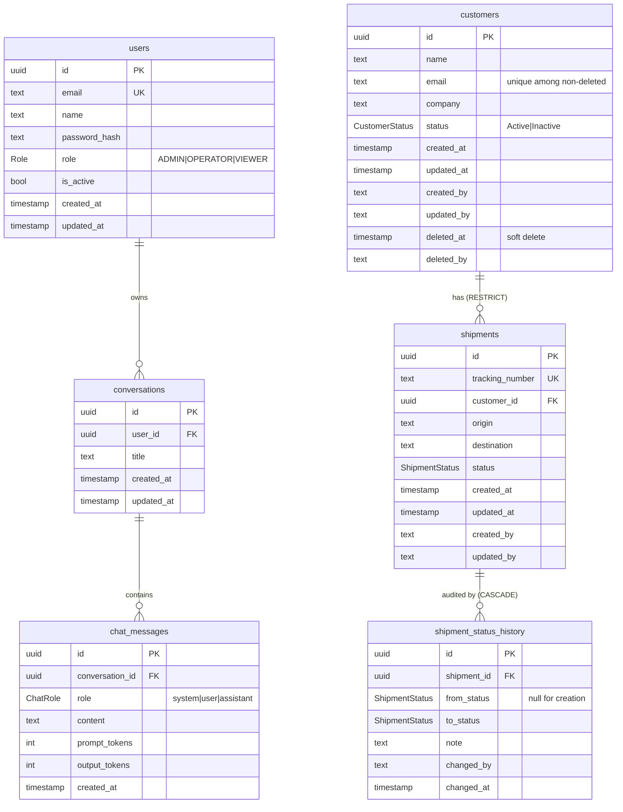

# Database Schema

PostgreSQL 14+ (Azure Database for PostgreSQL Flexible Server in production). Source of truth: [`backend/prisma/schema.prisma`](../backend/prisma/schema.prisma); SQL: [`backend/prisma/migrations/`](../backend/prisma/migrations/).

## ER diagram



Enum `ShipmentStatus`: `Created, PickedUp, InTransit, OutForDelivery, Delivered, Exception, Cancelled`.

## Mapping to the assessment schemas

| Assessment field | Column | Notes |
|---|---|---|
| Customer `name, email, company` | same | email normalised to lower case |
| Customer `status: Active \| Inactive` | `status` enum | default `Active`; soft delete also sets `Inactive` |
| Shipment `trackingNumber` | `tracking_number` | unique; generated (`SHP-` + 10 unambiguous chars) when omitted |
| Shipment `customerId` | `customer_id` | FK, must be an active customer |
| Shipment `origin, destination` | same | must differ |
| Shipment `status` | `status` enum | governed by the lifecycle state machine |

## Strategies

**Soft delete.** `customers.deleted_at/deleted_by`. Repositories always add `deleted_at IS NULL`, so application code cannot read deleted rows by accident. The FK from shipments uses `ON DELETE RESTRICT`, which makes hard-deleting a customer with history impossible.

**Uniqueness with soft delete.** A partial unique index `customers_email_active_key ON customers (LOWER(email)) WHERE deleted_at IS NULL` (custom SQL in the init migration) guarantees one active customer per email even under concurrent requests, while allowing a previously deleted email to be reused.

**Audit fields.** `created_at/updated_at` (Prisma `@updatedAt`), `created_by/updated_by` (actor email from the token), plus the append-only `shipment_status_history`.

**Keys.** UUID v4 primary keys: not guessable, safe to expose, merge-friendly across environments.

**Naming.** snake_case tables/columns in SQL via `@@map/@map`; camelCase in TypeScript.

## Indexes

| Index | Supports |
|---|---|
| `users_email_key` (unique) | login |
| `customers_deleted_at_idx`, `customers_status_idx`, `customers_email_idx` | list filters, duplicate check |
| `customers_email_active_key` (partial unique) | uniqueness among active customers |
| `shipments_tracking_number_key` (unique) | tracking lookup |
| `shipments_customer_id_idx`, `shipments_status_idx` | filters, dashboard `GROUP BY status` |
| `shipment_status_history_shipment_id_changed_at_idx` | ordered history per shipment |
| `conversations_user_id_updated_at_idx`, `chat_messages_conversation_id_created_at_idx` | chat sidebar, sliding history window |

For larger volumes, the `ILIKE` search would get a `pg_trgm` GIN index on `name/email/company` and `tracking_number/origin/destination`.

## Migrations

```bash
cd backend
npx prisma migrate deploy   # apply (CI/CD and production)
npx prisma migrate dev      # create a new migration while developing
npm run db:seed             # demo data (idempotent)
```

In the pipeline, migrations run once per release, before the slot swap (see [deployment guide](deployment-azure.md#5-deployment-strategy)); every migration must be backward compatible with the currently running version (expand → migrate → contract).
