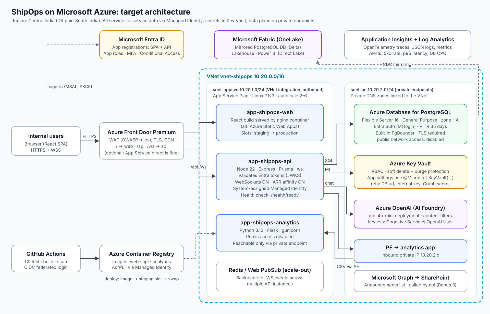

# Azure Deployment Guide (Module 6)



*(Editable source: [`diagrams/azure-architecture.svg`](diagrams/azure-architecture.svg). Infrastructure as code: [`infra/main.bicep`](../infra/main.bicep).)*

## 1. Resource inventory

| Resource | SKU / setting | Purpose |
|---|---|---|
| Resource groups | `rg-shipops-{dev,prod}` | one per environment |
| App Service Plan | Linux **P1v3**, zone redundant (prod), autoscale 2-6 | hosts the three apps |
| `app-shipops-web` | container (nginx + React build) | SPA. *Alternative: Azure Static Web Apps (cheaper, global CDN)* |
| `app-shipops-api` | Node 22 container, WebSockets **On**, ARR affinity **On**, Always On, HTTPS only, min TLS 1.2, health check `/health/ready` | API + WebSockets |
| `app-shipops-analytics` | Python 3.12 container, public network access **disabled**, private endpoint | analytics |
| Azure Database for PostgreSQL Flexible Server | PostgreSQL 16, General Purpose D2ds_v5, zone-redundant HA (prod), 35-day PITR, geo-redundant backup | system of record |
| Azure Key Vault | Standard, RBAC mode, soft delete + purge protection, private endpoint | secrets |
| Azure OpenAI (AI Foundry) | `gpt-4o-mini` deployment, private endpoint | assistant |
| Virtual network | `10.20.0.0/16`: `snet-appsvc` (delegated, VNet integration), `snet-pe` (private endpoints), `snet-pg` (optional, delegated if using VNet-injected Postgres) | network isolation |
| Private DNS zones | `privatelink.postgres.database.azure.com`, `privatelink.vaultcore.azure.net`, `privatelink.openai.azure.com`, `privatelink.azurewebsites.net` | name resolution to private IPs |
| Application Insights + Log Analytics | workspace-based | logs, traces, metrics, alerts |
| Azure Container Registry | Basic/Standard | images; apps pull with managed identity (AcrPull) |
| Azure Front Door Premium (optional) | WAF policy (Microsoft default rule set + bot protection) | edge TLS, WAF, routing, CDN |
| Azure Cache for Redis or Azure Web PubSub (when scaling out) | | WebSocket event backplane |

Naming follows the Cloud Adoption Framework abbreviations (`app-`, `asp-`, `psql-`, `kv-`, `vnet-`, `snet-`, `appi-`).

## 2. Application hosting (Azure App Service)

* **Containers** for all three apps from ACR. Same image promotes from dev → prod, so what was tested is what runs.
* **Configuration**: app settings per slot; secrets as Key Vault references; `WEBSITES_PORT=4000` (api), `5001` (analytics).
* **WebSockets**: enable *Web sockets*; keep *ARR affinity* on so a socket stays on one instance. The App Service front end closes idle connections after ~230 s; the server heartbeat (30 s) and client ping (25 s) keep them alive.
* **Health check**: `/health/ready` (checks the DB). Unhealthy instances are taken out of rotation and replaced.
* **Autoscale** (API): CPU > 70% for 10 min → +1; < 30% for 20 min → −1; min 2 (prod), max 6. Requires the Redis/Web PubSub backplane for correct WebSocket fan-out beyond one instance (see [architecture §4](architecture.md#scalability-considerations)).
* **Graceful shutdown**: the API handles `SIGTERM` (close sockets with 1001, drain HTTP, disconnect Prisma), so restarts and swaps don't cut requests.
* **Database connections**: pool `max=10` per instance; 6 instances × 10 = 60, well under the D2ds_v5 limit. Turn on the Flexible Server built-in **PgBouncer** (port 6432) if instances grow.

## 3. Database (Azure Database for PostgreSQL Flexible Server)

* **Network**: public access disabled; private endpoint in `snet-pe` (or VNet injection into a delegated subnet). The API reaches it through VNet integration.
* **Authentication**: Microsoft Entra authentication enabled. The API's managed identity is mapped to a PostgreSQL role with least privilege (`SELECT/INSERT/UPDATE/DELETE` on app tables only). A separate migration role (used only by the pipeline) owns the schema and can `CREATE/ALTER`. Password auth can be disabled entirely; until then the connection string lives only in Key Vault.
* **TLS** enforced (`require_secure_transport=on`); `sslmode=require` in the URL.
* **Resilience**: zone-redundant HA (automatic failover, ~60-120 s), 35-day point-in-time restore, geo-redundant backups for regional DR (restore into the paired region).
* **Maintenance**: custom maintenance window (Sunday 02:00 IST).
* **Monitoring**: Query Store + Intelligent Performance; alerts on CPU > 80%, storage > 85%, connection failures.

## 4. Authentication (Microsoft Entra ID)

Two app registrations:

| Registration | Type | Settings |
|---|---|---|
| `ShipOps API` | Web API | App ID URI `api://shipops-api`; scope `access_as_user`; **app roles** `ShipOps.Admin`, `ShipOps.Operator`, `ShipOps.Viewer` (assignable to users/groups) |
| `ShipOps Web` | SPA | redirect URI `https://<web>/`; delegated permission to `api://shipops-api/access_as_user`; auth code flow with PKCE (no secrets in the browser) |

Flow: the SPA signs users in with **MSAL** (`@azure/msal-react`), acquires an access token for the API scope and sends it as `Bearer`. The API (`AUTH_MODE=entra`) validates the token's signature against the tenant JWKS, plus issuer, audience and expiry (`src/modules/auth/token.service.ts`), maps the `roles` claim to `ADMIN/OPERATOR/VIEWER`, and provisions the user record just-in-time for audit fields and chat ownership. WebSocket upgrades use the same token.

Tenant-side controls: assign roles via Entra **security groups**; enforce **MFA** and device compliance with **Conditional Access**; require user assignment on the enterprise app so only assigned staff can sign in.

Service-to-service identity: each App Service has a **system-assigned managed identity**. No client secrets are needed for Key Vault, ACR, PostgreSQL or Azure OpenAI.

## 5. Secrets management (Azure Key Vault)

| Secret | Consumer | Notes |
|---|---|---|
| `database-url` | api | only while password auth is used; removed after switching to Entra DB auth |
| `jwt-secret` | api | only for `AUTH_MODE=local` (non-prod) |
| `analytics-internal-key` | api, analytics | rotated quarterly; both apps read the same reference |
| `openai-api-key` | api | only if not using managed identity |
| `graph-client-secret` | api | prefer managed identity + `Sites.Selected` instead |

* RBAC: apps get **Key Vault Secrets User** on the vault (read secret values only); engineers get no data-plane access in prod; the pipeline identity gets **Key Vault Secrets Officer** only if it seeds secrets.
* App settings reference secrets: `ANALYTICS_API_KEY=@Microsoft.KeyVault(SecretUri=https://kv-shipops-prod.vault.azure.net/secrets/analytics-internal-key/)`. App Service caches and refreshes them; referencing without a version picks up rotations automatically (within 24 h, or immediately on restart).
* Soft delete + purge protection; diagnostic logs to Log Analytics; alert on unusual `SecretGet` volume.
* Private endpoint, public network access disabled.

## 6. Networking

* **VNet integration** (`snet-appsvc`, delegated to `Microsoft.Web/serverFarms`) gives the apps outbound access into the VNet; *Route All* sends all outbound traffic through it, so it can be inspected by NSGs/firewall.
* **Private endpoints** (`snet-pe`) for PostgreSQL, Key Vault, Azure OpenAI and the analytics app. Their public endpoints are disabled. Private DNS zones are linked to the VNet so the normal hostnames resolve to private IPs.
* **Inbound**: web and API are public behind Front Door (or App Service access restrictions that allow only the Front Door service tag + `X-Azure-FDID` header). Analytics accepts traffic only via its private endpoint. SCM/Kudu sites are restricted to the build agents.
* **NSGs** on subnets: `snet-pe` allows 5432/443 only from `snet-appsvc`.
* **Egress**: optional Azure Firewall / NAT Gateway for a fixed outbound IP (useful when SharePoint/partners allow-list IPs).

**Private endpoint vs. VNet injection for PostgreSQL** (design discussion): VNet injection (delegated subnet) is simpler but locks the server into one VNet and requires that address planning be done up front; private endpoint is more flexible (reachable from peered VNets, on-prem via ExpressRoute/VPN, and from Fabric's managed private endpoints for mirroring). I chose **private endpoint**.

## 7. Deployment strategy

```mermaid
flowchart LR
  PR[Pull request] --> CI[CI: lint · typecheck · unit + integration tests · build · Trivy scan]
  CI -->|merge to main| B[Build & push images<br/>tag = git SHA]
  B --> DEV[Deploy to dev]
  DEV --> SM[Smoke tests]
  SM -->|manual approval| MIG[prisma migrate deploy<br/>prod DB]
  MIG --> STG[Deploy to prod staging slot]
  STG --> WARM[Warm-up + health check]
  WARM --> SWAP[Slot swap → production]
  SWAP -->|errors spike| RB[Swap back = rollback]
```



* **Environments**: dev and prod (add test/UAT as needed), each fully described by Bicep with environment parameter files.
* **Blue/green via deployment slots**: new image goes to the `staging` slot with production settings, App Service warms it up (hits `/health/ready`), then swaps. Rollback = swap again (seconds). WebSocket clients reconnect automatically with backoff.
* **Database migrations** run once per release, before the swap, using the migration identity. They must be backward compatible (expand → deploy → contract) so the old slot keeps working during the swap and after a rollback.
* **Immutable artifacts**: images tagged with the commit SHA; the same digest goes to dev and prod.
* **Configuration drift**: all settings in Bicep; manual portal changes are not allowed in prod (Azure Policy / RBAC).

## 8. Security considerations

| Layer | Controls |
|---|---|
| Identity | Entra ID SSO, MFA, Conditional Access, app roles via groups, managed identities everywhere, no shared admin accounts |
| Network | private endpoints, public access disabled on data services, VNet integration with Route All, NSGs, WAF at the edge, Kudu restricted |
| Data | TLS 1.2+ in transit; encryption at rest (service-managed keys, or customer-managed keys in Key Vault if required); PITR + geo backups; least-privilege DB roles; soft delete and audit trail |
| Application | Zod validation, RBAC per route, Helmet, strict CORS, WS origin check, rate limiting, request size limits, no stack traces in prod, log redaction |
| Secrets | Key Vault only, no secrets in repo/pipeline/app settings, rotation |
| Supply chain | Dependabot, `npm audit`/`pip-audit`, Trivy image scan, pinned base images, ACR with admin user disabled |
| AI | Azure OpenAI with content filters, private endpoint, keyless auth, read-only tools, data not used for training, prompt-injection guidance |
| Monitoring | Defender for Cloud (App Service, Databases, Key Vault, OpenAI plans), Application Insights alerts, Key Vault & DB diagnostic logs, activity log alerts on role assignments |
| Compliance | Region pinned to India (Central India + South India) for data residency |

## 9. CI/CD approach

GitHub Actions (see [`.github/workflows`](../.github/workflows)):

* `ci.yml` (every PR/push): API typecheck, unit tests and integration tests against a Postgres service container; analytics pytest; web typecheck, tests and build; Docker builds.
* `deploy.yml` (main / manual): logs in to Azure with **OIDC workload identity federation** (no stored credentials), builds and pushes images to ACR, runs migrations, deploys to the staging slot, smoke-tests, swaps. Production is gated by a GitHub *environment* with required reviewers.

Azure DevOps Pipelines would follow the same stages if that's the team standard.

## 10. Observability and operations

* Application Insights via OpenTelemetry (`@azure/monitor-opentelemetry` in Node, `azure-monitor-opentelemetry` in Python) for distributed traces API → analytics → PostgreSQL; `x-request-id` is propagated between services and present in every log line.
* Workbooks: request rate/latency/errors per endpoint, WebSocket connection count, chat token usage and latency, analytics processing time.
* Alerts: 5xx > 2% (5 min), p95 > 1.5 s, health-check failures, DB CPU > 80%, OpenAI 429s.
* Runbook items: slot rollback, PITR restore, secret rotation, regional failover.

## 11. Step-by-step: manual first deployment

```bash
# Variables
RG=rg-shipops-dev; LOC=centralindia

az group create -n $RG -l $LOC
az deployment group create -g $RG -f infra/main.bicep -p infra/main.dev.bicepparam

# Push images
ACR=$(az deployment group show -g $RG -n main --query properties.outputs.acrName.value -o tsv)
az acr login -n $ACR
for s in backend analytics frontend; do
  docker build -t $ACR.azurecr.io/shipops-$s:v1 ./$s && docker push $ACR.azurecr.io/shipops-$s:v1
done

# Secrets
az keyvault secret set --vault-name kv-shipops-dev --name analytics-internal-key --value "$(openssl rand -base64 32)"
az keyvault secret set --vault-name kv-shipops-dev --name jwt-secret --value "$(openssl rand -base64 48)"
az keyvault secret set --vault-name kv-shipops-dev --name database-url --value "postgresql://...&sslmode=require"

# Migrate (from a runner inside the VNet, or temporarily allow your IP on a dev server)
cd backend && DATABASE_URL=... npx prisma migrate deploy && npm run db:seed

# Point apps at the images
az webapp config container set -g $RG -n app-shipops-api-dev --container-image-name $ACR.azurecr.io/shipops-backend:v1
```

**Cost note (indicative, dev)**: one P1v3 plan shared by the three apps, a Burstable B1ms PostgreSQL server and Basic ACR keep dev cheap; prod adds zone redundancy, General Purpose PostgreSQL with HA, Front Door Premium and Defender plans. Size from real load tests before committing.
